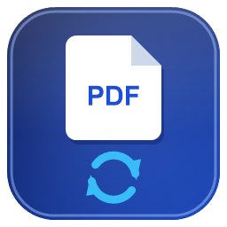

<p align="center">
  
</p>

# miPDFconvert

[](https://github.com/Mibuw/miPDFconvert/releases/latest) [](LICENSE) [](https://github.com/microsoft/winget-pkgs/tree/master/manifests/m/Mibuw/miPDFconvert) [](https://community.chocolatey.org/packages/mipdfconvert)

A virtual PDF printer for Windows. Install it and a new printer named **miPDFconvert**
appears in Windows. Anything you print to it is converted to a PDF, which is then either
handed to a configurable **target application** or offered to you through a *Save As* dialog.

The PDF conversion uses [miPDFlib](https://github.com/Mibuw/miPDFlib), a PDF library with its
own PostScript interpreter in managed code — no Ghostscript or other external engine is needed.
miPDFconvert is released under the **Apache License 2.0** — see [Licensing](#licensing).

## How it works

```
Application  ──►  "miPDFconvert" printer  ──►  print monitor (miPDFport.dll)
                  (Microsoft PostScript class        │  writes the PostScript job to a file
                   driver + miPDFconvert PPD)        │  only the printing user can read
                                                     ▼
                              miPDFconvert (started in the user's session)
                                                     │  PostScript ──► PDF with miPDFlib
                                                     │
                        ┌────────────────────────────┴────────────────────────────┐
                        ▼                                                         ▼
        TARGET_APPLICATION is set:                               TARGET_APPLICATION is empty:
        the PDF is passed to that app                            a "Save As" dialog is shown
```

The printer embeds the fonts the application uses (the PPD lists no printer-resident fonts),
so the PDF keeps the original fonts.

## Requirements

- **Windows** 10/11, 64-bit (x64 or ARM64).
- **.NET 8 Desktop Runtime (x86)** — on an attended install the setup offers a download link
  if it is missing; for silent installs, install it beforehand (the Chocolatey package does
  this automatically).

Nothing else is needed: no Ghostscript and no Visual C++ Redistributable.

## Installation

### Via package manager

**winget:**

```powershell
winget install mipdfconvert
```

**Chocolatey:**

```powershell
choco install mipdfconvert
```

> Newly submitted versions can take a few days to appear while they pass winget/Chocolatey moderation.

### Manual

1. Run the installer `miPDFconvertSetup_<version>.exe`. During setup you can optionally choose
   a **target application** that should automatically receive the generated PDF — the selected
   path is written to `TARGET_APPLICATION` in `miPDFconvert.dll.config` (leave it empty for a
   *Save As* dialog; changeable later).
2. Print to the **miPDFconvert** printer from any application.

## Configuration

Settings live in `miPDFconvert.dll.config` (next to `miPDFconvert.exe` in the install
directory), under `<appSettings>`. An update keeps the existing file.

| Key | Default | Description |
|-----|---------|-------------|
| **`TARGET_APPLICATION`** | *(empty)* | Path or name of an application that should **automatically receive the generated PDF** as a command-line argument. A relative path/bare file name is resolved against the install directory first. **Leave empty to get a *Save As* dialog instead.** |
| `CREATE_DOCUMENT_FILES` | `false` | If `true`, keep the PostScript received on standard input (`-ps` mode) as `miPDFconvert.ps` in `%TEMP%`. |

### Defining a target application

Set `TARGET_APPLICATION` to the program that should open the freshly created PDF. The PDF
is written to a temporary file and passed as the first argument, so anything that accepts a
file path works — for example a PDF viewer, an archiving tool, or your own application:

```xml
<add key="TARGET_APPLICATION" value="C:\Program Files\YourApp\YourApp.exe" />
```

The **installer** also offers an optional page to pick a target application; the chosen path
is written to this setting during installation (leave it empty for the *Save As* dialog).

The target application is brought to the foreground automatically (including single-instance
apps such as browser-based viewers). If `TARGET_APPLICATION` is empty, miPDFconvert falls
back to a *Save As* dialog.

## Components

| Folder | Component |
|--------|-----------|
| `miPDFconvert/` | The application (.NET 8, WPF): converts the print job with miPDFlib and hands the PDF on. |
| `printer/miPDFport/` | Print monitor (C++): one port, `miPDFconvert:`; writes each job to `%ProgramData%\miPDFconvert\Spool` and starts miPDFconvert in the session of the printing user. |
| `printer/PrinterSetup/` | `PrinterSetup.exe install <folder>` / `uninstall` (.NET Framework 4.7.2): installs the monitor, the printer driver and the printer. |
| `printer/miPDFconvert.ppd` | PostScript printer description for the Microsoft PostScript class driver. |
| `miPDFconvertSetup/` | Inno Setup script. |

The Microsoft PostScript class driver (`pscript5`) is part of Windows; `PrinterSetup.exe`
takes it from the driver store of the computer it runs on, so it is not part of this
repository or the installer.

## Building from source

Prerequisites:

- **Visual Studio** (2022 or later) with the **C++ (v145)** toolset for x64 and ARM64 (for
  the print monitor) and the **.NET desktop** workload. Override the toolset with
  `-PlatformToolset` if you have a different version installed (e.g. `v143`).
- **.NET 8 SDK**.
- **Inno Setup 6** — https://jrsoftware.org/isdl.php (for building the installer).

Build everything (print monitor → PrinterSetup → application → installer) with the included
script:

```powershell
.\build.ps1
```

Useful switches: `-SkipNative` (skip the print monitor), `-SkipSetup` (binaries only),
`-PlatformToolset v143` (override the C++ toolset). The finished installer is written to
`miPDFconvertSetup\Release\miPDFconvertSetup_<version>.exe`.

### Code signing (optional)

Release builds can be Authenticode-signed; signing is **off by default**. To sign the
project's own binaries and the installer (with timestamp):

```powershell
$env:MIPDF_SIGN_SUBJECT = "Your certificate subject (CN)"
.\build.ps1 -Sign
```

The certificate subject is taken from `-SignSubject` or the `MIPDF_SIGN_SUBJECT`
environment variable and is intentionally **not** stored in the repository. Signing uses
`signtool.exe` (auto-located from the Windows SDK) and the Certum timestamp server. The
installer and uninstaller are signed by Inno Setup through a sign tool named `certum`
that must be configured locally (Inno Setup IDE → *Tools → Configure Sign Tools*);
`build.ps1 -Sign` activates it by passing `/DSIGN` to ISCC.

## Roadmap

Microsoft is phasing out third-party printer drivers, and in **Windows Protected Print Mode**
(Windows 11 24H2 and later, enabled by policy) the spooler loads no third-party drivers and only
Microsoft-signed modules – so a print monitor DLL like `miPDFport.dll` cannot run there.
Background: [PostScript to PDF without Ghostscript: lessons from a virtual printer](https://www.mitterbucher.com/en/articles/postscript-to-pdf-without-ghostscript/).

- **Virtual printer as an app (Windows 11 24H2 and later)** – a second edition of miPDFconvert
  based on Microsoft's [Print Support App v4 virtual printer](https://learn.microsoft.com/en-us/windows-hardware/drivers/devapps/print-support-app-v4-design-guide)
  architecture: packaged as MSIX, no own driver or print monitor, so it also works with
  Protected Print Mode. PostScript as the input format (converted with miPDFlib) and PDF
  passthrough for applications that print PDF themselves. Open question before committing to
  the design: how to hand the PDF to a desktop target application from the app's background task.
- **The classic printer stays** for Windows 10 and for systems without Protected Print Mode.

## Logging

Logs are written to `%ProgramData%\miPDFconvert\`: `miPDFconvert.log` (application),
`miPDFport.log` (print monitor) and `PrinterSetup.log` (printer installation).

## Licensing

miPDFconvert is licensed under the **Apache License, Version 2.0** — see [`LICENSE`](LICENSE)
and [`NOTICE`](NOTICE). Third-party components and their licenses are documented in
[`THIRD-PARTY-NOTICES.md`](THIRD-PARTY-NOTICES.md):

- **miPDFlib / miPDFlib.PostScript** (PDF conversion) — Apache-2.0
- **Apache log4net** (logging) — Apache-2.0
- **System.Security.Cryptography.Pkcs** and related .NET libraries — MIT

> **Earlier versions:** Up to version 1.1.1, miPDFconvert was licensed under the GNU AGPL v3
> and contained code derived from mfilemon and clawPDF/PDFCreator as well as Ghostscript.
> Since version 1.2.0, none of these components is part of miPDFconvert; the earlier versions
> remain available under their original licenses in the Git history.

---

## Author

**Wolfgang Mitterbucher** — Software Engineering & Digital Identity, Leonding (Austria)

🌐 [www.mitterbucher.com](https://www.mitterbucher.com) · 💼 [LinkedIn](https://at.linkedin.com/in/wolfgangmitterbucher) · ✉️ office@mitterbucher.com

**More open-source projects:** [miPDFconvert](https://github.com/Mibuw/miPDFconvert) · [miPDFlib](https://github.com/Mibuw/miPDFlib) · [miPDFvalidator](https://github.com/Mibuw/miPDFvalidator) · [miEUDIverifier](https://github.com/Mibuw/miEUDIverifier)
